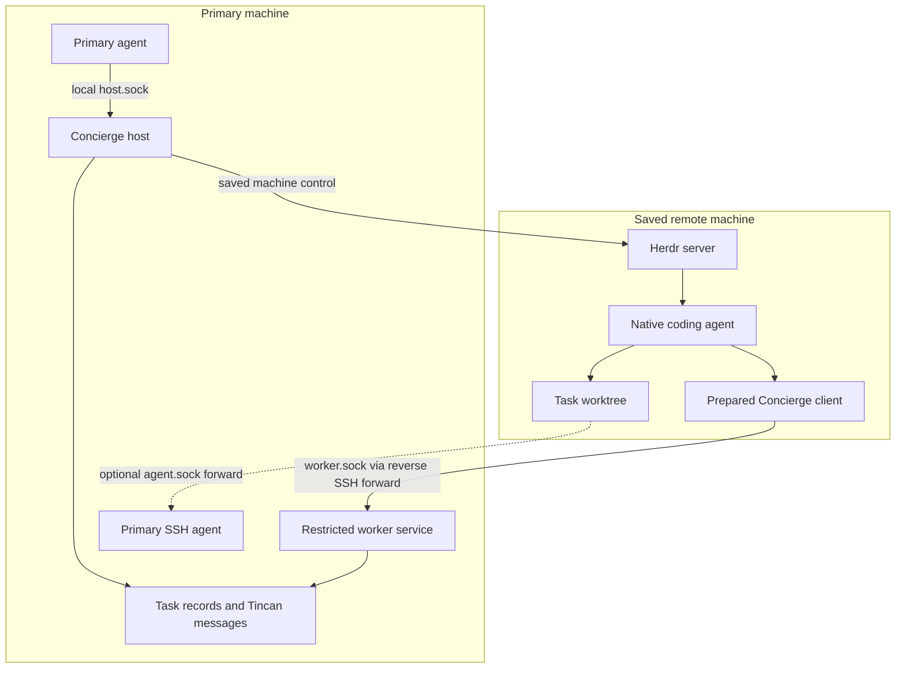
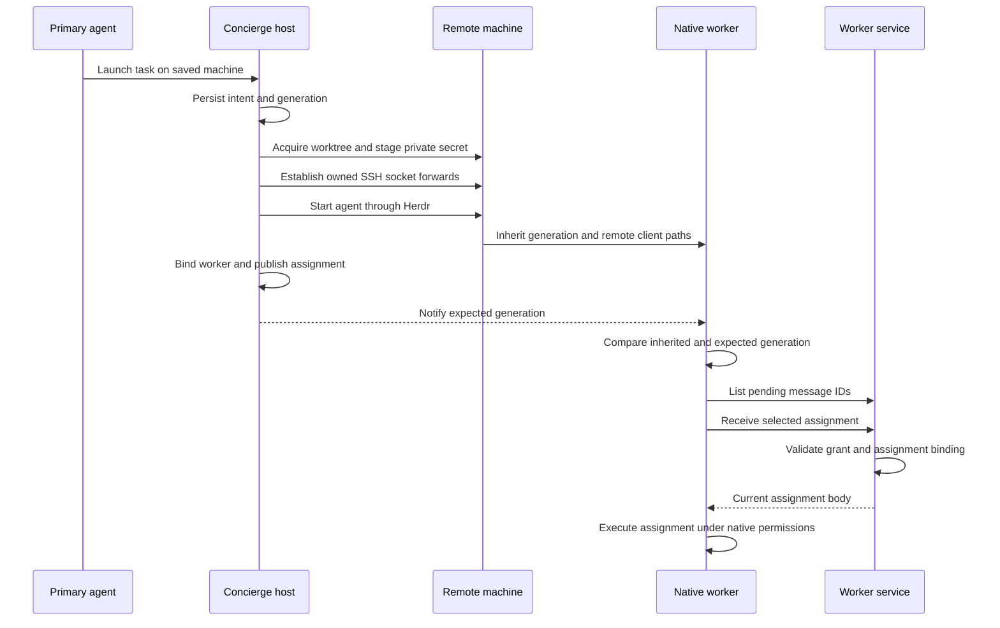
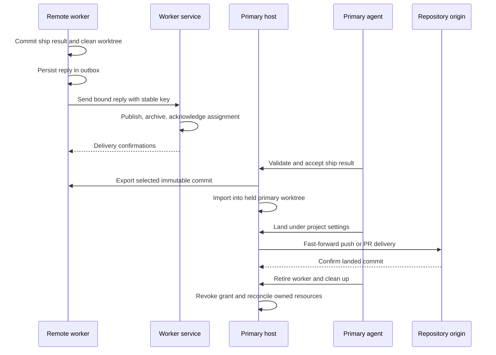

# Remote worker architecture

A single primary host coordinates local and remote tasks. Moving a worker to
another machine changes its execution location and transport. The primary
continues to own authoritative task records, assignment validation, result
acceptance, and repository delivery.

Read [setup](remote-setup.md) for installation and launch commands, or
[operations](remote-workers.md) for recovery and cleanup procedures.

## Components and boundaries

The diagram shows logical connections. The primary starts and owns the SSH
process that creates the reverse Unix socket forwards on the remote. Its
`host.sock` remains local. The remote `worker.sock` connects to a separate,
restricted worker service on the primary.

| Component | Responsibility |
| --- | --- |
| Primary agent | Queue work, inspect results, accept work, and request authorized landing. |
| Concierge host | Record launch progress, own tunnels, supervise workers, import results, and reconcile cleanup. |
| Task records | Retain generations, launch intent, machine identity, grants, leases, connection observations, and result selection. |
| Tincan | Store assignments and replies durably; notify the corresponding agent. |
| Worker service | Authenticate the task and generation; admit only worker protocol operations. |
| Herdr | Resolve saved machines and control remote workspaces, panes, and native agent processes. |
| Prepared remote client | Run the committed Concierge revision built during machine preparation. |
| Worktree manager | Acquire and return remote worktrees and primary result leases; use Treehouse where available and the remote Git fallback where required. |

The optional agent forward is separate from the worker protocol. It connects a
fixed remote `agent.sock` to the primary's `SSH_AUTH_SOCK`. The host recovers
both forwards together. Repository authentication can instead use credentials
already provisioned on the remote.

## Preparation and launch

Preparation resolves the saved Herdr profile and validates the declared remote
base and repository origins. A Git bundle transfers the clean primary client's
committed revision. Remote Nix builds that revision and records the prepared
client. No source-repository push is required for this transfer.

Launch records its intent before creating external resources. It captures the
stable machine identity, destination, authentication mode, and client revision.
Retries reconcile that same intent and its resources. They cannot silently
switch to a newer prepared client or another destination.

The host stages a random secret through SSH stdin in a private generation
directory. The primary retains its verifier. Prompts, command arguments, logs,
and Git do not carry the secret. The worker inherits its generation from native
startup and checks it against each notification before requesting work.

The worker service permits pending-message listing, bootstrap inspection and
acknowledgement, assignment receive and acknowledgement, settings reads, and
bound replies. It does not expose the host's launch, landing, or configuration
operations. The service binds the state root and primary recipient itself.

An assignment body becomes actionable only after `receive` reports it current.
A pending-list entry or a notification alone does not authorize execution.
Scouts retain their read-only contract. Native agent trust, sandbox, and approval
rules remain active for both scout and ship workers.

## Reply, result import, and delivery

A remote reply has a durable local outbox record before its first network send.
The record retains the original assignment, generation, reply key, and body.
Publication, report archival, and assignment acknowledgement have separate
confirmations. An identical retry can finish an interrupted step.

The result-import steps apply to ship workers. Scouts return reports without a
code-result import. A ship worker commits its result and removes its generated
ignored files before reporting. Export permits ignored outputs that remain in
the checkout. Export leaves those outputs untouched and retains the lease.
The ownership and reserved-branch checks still apply. Tracked changes and
non-ignored untracked files block export. A retry requires the selected HEAD.
The primary selects an exact commit and imports it
into a worktree sharing the primary project's Git common directory. Interrupted
imports retain the same selected commit and lease holder.
Only committed content and history enter the bundle. Lease return still
requires its cleanup and process checks. The primary derives return authority
from recorded acceptance and fresh landing evidence. A trusted landed-result
proof or accepted-scout proof authorizes `git reset --hard HEAD` and
`git clean -fdx` after lease, commit, and process checks. The remote uses the
shared local cleanup implementation. Both return paths report removed paths
and verify cleanliness. Remote diagnostics reach the primary host log and
cleanup output, including completed removals after a partial failure.

Unchanged and abandoned proofs keep conservative validation. Only those return
paths use the primary's operator-owned `return_ignored_paths` list. Unmatched
ignored files remain and are named in the error. Workers and remote-side files
cannot supply deletion authority. Journal retries preserve the original proof.

The primary retains the remote result and imported primary lease until cleanup
succeeds. Landing follows repository settings: fast-forward delivery pushes the
verified commit to the default branch; PR delivery publishes from the primary
and uses the existing check and squash-merge rules. Merge authority still
controls whether operator approval is required. A changed selected HEAD or a
conflicting published branch stops delivery.

## Disconnects and retirement

Herdr reachability and worker-tunnel reachability have independent observations
and retry schedules. A failed probe records an unreachable connection. It
preserves the generation and leases without consuming a worker restart attempt.
Retry delays grow from one second to a maximum of one minute. Recorded tunnel
ownership and retry deadlines survive primary host restarts.

Revocation ends a worker's network access. It does not erase an unsent outbox
record. The trusted primary can reconcile an original retained reply without
reactivating the worker. The [operations guide](remote-workers.md) gives the
exact recovery command and preservation rules.

Retirement revokes the grant and closes the owned tunnel. Cleanup requires
confirmed agent quiescence, known resource ownership, a clean worktree, and
evidence that changed work landed or was explicitly abandoned. Uncertain
ownership or an unconfirmed lease return retains resources for inspection.
Outbox records live outside the worktree and survive its cleanup.

## Implementation map

| Package | Remote responsibility |
| --- | --- |
| [`pkg/machineprep`](../pkg/machineprep) | Prerequisite checks, owned repository setup, and client build. |
| [`pkg/herdr`](../pkg/herdr) | Saved machine resolution and native remote control. |
| [`pkg/hostservice`](../pkg/hostservice) | Remote launch, activation, recovery, result import, landing, and retirement. |
| [`pkg/remoteworker`](../pkg/remoteworker) | Secret staging, SSH socket transport, and durable tunnel ownership. |
| [`pkg/workerservice`](../pkg/workerservice) | Restricted worker request dispatch. |
| [`pkg/taskops`](../pkg/taskops) | Assignment and reply operations, remote worker instructions, and lifecycle effects. |
| [`pkg/taskstate`](../pkg/taskstate) | Authoritative task transitions and retained remote identities. |
| [`pkg/replyoutbox`](../pkg/replyoutbox) | Durable remote reply staging and confirmation records. |

See the general [architecture guide](architecture.md) for the remaining packages.
